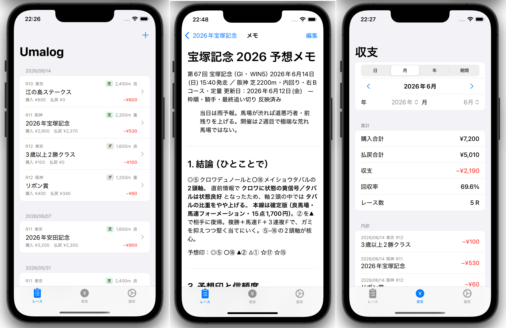

# umalog

競馬の予想メモと馬券収支を記録するiOSアプリです。

レースごとに出走馬の予想印を付け、馬券の購入内容と払戻結果を入力すると、日別・月別・年別・任意期間の収支をまとめて確認できます。データはデバイス内にのみ保存され、外部への送信はありません。

## アプリイメージ

## 主な機能

- 出走馬ごとの予想印（◎ ○ ▲ △ ☆ 注 押 消）
- 馬券の種類・買い目・購入額・払戻額の管理
- ボックス・フォーメーションの点数自動計算
- 日別 / 月別 / 年別 / 任意期間の収支集計と回収率の表示
- シェイクで直前の削除を取り消し（Undo）
- CSV / ZIP でのデータエクスポート・インポート

## 使い方

1. 「レース」タブの＋ボタンでレースを追加する
2. レース詳細から出走馬を登録し、予想印を設定する
3. 馬券を登録して購入額を入力する
4. レース後に着順と払戻額を入力する
5. 「収支」タブで期間を選んで集計を確認する

## インストール方法

App Storeにて近日公開予定です。

## 開発時の品質チェック

ローカルでは整形・Lint・ビルドと変更に関連するテストを実行します。全件テストはGitHub Actionsの「iOS 品質チェック」で手動実行し、その間にMacのSimulatorで見た目・操作・仕様を確認できます。

1. 作業ブランチをコミット・pushする。
2. GitHubの **Actions → iOS 品質チェック → Run workflow** で対象ブランチを選び、実行する。
3. 実行画面に表示されるコミットが検証対象と一致していることを確認する。
4. 完了後に各ステップの結果とSummaryを確認し、Artifactsからログとxcresultを取得する。xcresultはMacのXcodeで開ける。
5. 最新コミットの全件テストと手動確認が両方完了してから、マージを判断する。実行中・キャンセル・タイムアウトは検証完了として扱わない。

ワークフローはpushやPR更新だけでは起動しません。同じブランチで再実行すると古い実行をキャンセルします。再実行を始めない限り、追加のpushだけでは実行中の検証対象は変わりません。

初回はワークフローを`main`にマージしてから手動実行できます。導入PRでは設定の検証結果と、macOS上で未確認の項目を区別します。マージ後に初回実行を行い、失敗があればIssue #66で追跡します。

整形チェックはSwiftFormat 0.64.4（方言はSwift 6.2）、LintはSwiftLint 0.63.3に固定しています。AGENTS.mdに記載された使用版を基準にした初期値で、Macに現在インストールされている版との一致は初回確認が必要です。ローカルの`swiftformat --version`、`swiftlint version`と照合してください。更新時はワークフローの版・配布物のSHA-256と、この記載を合わせて変更します。検査対象は既存設定どおりアプリとユニットテストです。

Xcode 27.1 / iPhone 18 Pro / iOS 27.0で全ユニット・UIテストを実行します。UIは標準ランナー向けに2並列から開始し、既存テストプランの診断収集設定を維持します。両テストの行カバレッジを合算し、`umalog.app`の85%以上を合格条件にします。片方の計測が0行の場合も失敗にするため、ログ・結果を調べてから再実行してください。ブランチカバレッジは計測していません。

前段の失敗時は後続の検証を止め、生成済みのログ・結果を7日保存します。環境準備前の失敗・強制終了・キャンセル時は、成果物がない場合があります。ジョブ全体は90分、Simulator起動は10分、ユニットテストは30分、UIテストは40分で打ち切ります。

初回はActionsの各ステップ所要時間・起動待ち時間、`unit.log` / `ui.log`のビルド・テスト時間、`unit-summary.json` / `ui-summary.json`の実行件数と結果、Summaryの圧縮前容量・Artifactsの保存サイズをIssue #66に記録し、並列数と上限時間を調整します。

CodeQL・Sanitizer・依存ライブラリの脆弱性検査はこのワークフローに含めていません。ミューテーションテスト・PBTも追加しません。

## 免責事項

本アプリは予想・馬券の記録を目的とした個人向けツールです。馬券の購入・払戻・ベッティングに関する機能は一切含まれていません。

本アプリの利用により生じた損害（記録の誤り・データ損失・収支判断の相違等）について、開発者はいかなる責任も負いません。
