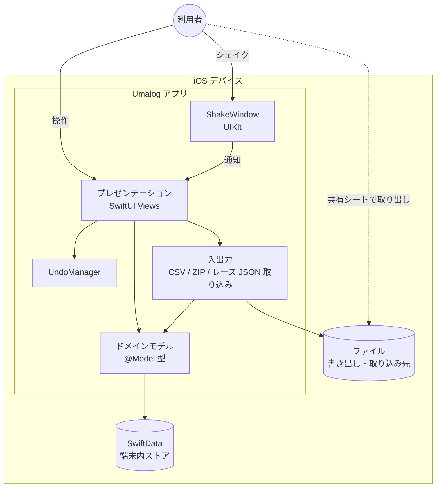
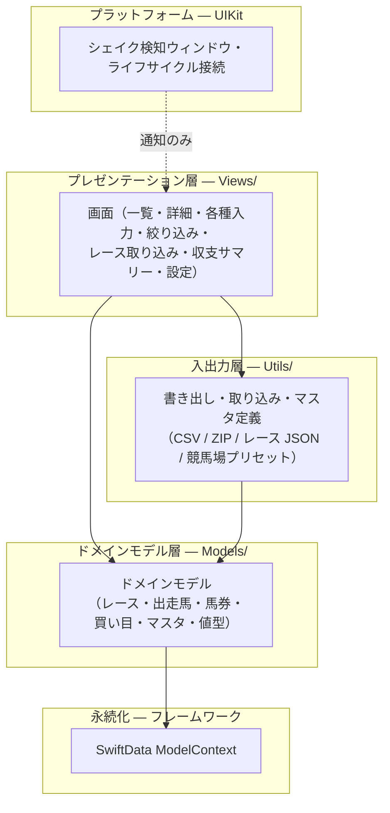

# アーキテクチャ

この文書は、どの構造・制約で実現するかと、その理由を残す。現在のクラス・関数の一覧、内部の呼び出し順序、詳細なデータアクセス手順は、この文書では保守しない。必要になったら、その時点のコードを AI に読ませて図や説明を作らせ、対象コミットと確認した範囲を添えた参考説明として扱う（設計文書には加えない）。コードを読み直すだけでは分からない責務の分担、禁止する接続、保存と復旧の境界と、それらの理由をここに残す。利用者に見える動作は [specification.md](specification.md)、目的と目標は [requirements.md](requirements.md)、検証の計画は [tests.md](tests.md) を参照。

## 全体構成と境界

Umalog は単一利用者・単一デバイス向けのアプリケーションで、プロセス境界を1つしか持たない。ネットワーク通信を行う構成要素は存在しない。

外部システム・サーバー・アカウント基盤との接続は構成上存在しない。

### 不変条件・境界

**常に成り立たなければならない約束**

- **ネットワーク通信を行うコードが存在しない。** サーバー、アカウント基盤、解析 SDK、広告 SDK のいずれも持たない。この「存在しない」ことがプライバシー要件の実体である。
- **馬券購入サービスへの導線が存在しない。** リンク・ボタン・ディープリンクのいずれも置かない。
- **機能を制限する課金が存在しない。** 課金による分岐をコード上に持たない。
- **予想印はちょうど8種。** 追加も削除もしない。1頭につき1つだけ付き、印なしを許容する。
- **収支の集計はレースの開催日を基準とする。** 記録の作成日時では集計しない。払戻が未入力の馬券は0円として扱う。
- **購入額・収支・回収率を保存しない。** すべて記録から導出する。二重管理を避けるため、独立した列や集計テーブルを持たない。

**CloudKit 互換のための制約（ADR-003）**

- すべてのリレーションシップはオプショナル（`?`）であること。
- 並び順は `sortIndex: Int = 0` で表現し、SwiftData の順序付きリレーションを使わないこと。
- `@Attribute(.unique)` を使わないこと。

**取り消しの呼び出しに関する境界**

- 取り消しの呼び出しをデバイスのシェイクに依存している。シェイクを前提にできないプラットフォームへ展開する場合は、代替の取り消し導線を別途用意する。

**外部データ取得を検討する場合の境界**

- 出走馬情報などの自動取得は「ローカル完結・外部送信なし」と衝突しうる。取り込む場合も、アプリが自発的に通信しない設計（利用者が明示的に持ち込んだデータのみを扱う等）を守る。

## 責務と依存方向

**依存のルール**

- 依存は上から下へのみ流れる。`Models/` は `Views/` と `Utils/` を知らない。
- `Utils/` は `Views/` を知らない。入出力はモデルとファイルの間だけで完結する。
- UIKit 層からプレゼンテーション層へは、`NotificationCenter` 経由の通知のみ。逆向きの参照を持たない。
- 業務ロジックは軽量に保ち、画面がドメインモデルを直接扱う。集計・組合せ点数などの派生値はモデル側の計算プロパティとして導出する。
- 以上の層間依存の制約は、単一ターゲット構成のためビルド構造では強制していない。PR レビュー（AI を含む）で本書と照合して守る。

### レース取り込みの責務

- 解析・検証・照合（差分の計算）・保存は入出力層の取り込み処理（`RaceJSONImporter`）が担い、画面（`RaceJSONImportView`）はプレビューと確定だけを持つ。検証や照合の規則を画面側に書かない。
- 保存は利用者が確定したときの 1 回だけで、それまでモデルコンテキストを変更しない。保存前に差分を確認し、確定したときだけ反映する約束（[specification.md](specification.md) の「レースの取り込み」）を守るため。
- 追加と更新は入口から分け、1 つの処理で「あれば更新、なければ追加」にしない。AI の出力がぶれても、別のレースに紐づいたり二重登録されたりしないため。
- 同じレース（開催日・競馬場名・R番号）と同じ出走馬（レース内の馬番）の照合は、アプリ側で調べる。`@Attribute(.unique)` を使えないため（ADR-003、ADR-010）。
- 検証の正はアプリ側の検証であり、AI 向けプロンプトの JSON Schema は AI への説明として使う。JSON Schema だけでは「着順の馬番は `entries` にある」「JSON に無い馬は削除される」を伝えきれないため、指示文を添える。
- JSON Schema の選択肢（競馬場・印・グレード・馬場状態）は、検証と同じアプリの定義から組み立てる。別々に書くと、プロンプトと検証が食い違うため。

## 設計判断と理由（ADR）

追記のみのログとして扱う。決定が変わった場合は既存の記録を書き換えず、新しい記録を追加して相互にリンクする。

### ADR-001: データの入力方法は手動入力とする

#### ステータス（Status）

Accepted

#### 意思決定内容（Decision）

出走馬などのレース情報は利用者が手で入力する。外部データソースとの連携を行わない（AI 出力の JSON テキスト貼り付けによる補助は [ADR-010](#adr-010-ai-が出力した-json-テキストの貼り付けで入力を補う) を参照）。

#### 背景（Context）

入力の手間を減らしたいが、自動取得は保守コストと規約上の制約を伴う。

#### 影響（Consequences）

入力の手間が残る。代わりに外部形式に依存しないため保守が不要になり、中央・地方・海外を問わず記録できる副次的な利点を得た。入力負担はオートコンプリート、開催情報の引き継ぎ、競馬場プリセットで緩和する。

#### 他に検討したもの（Alternatives Considered）

- JRA-VAN データラボ（公式）— 月額制かつ Windows 専用で、macOS / iOS から利用できない。
- スクレイピング（netkeiba 等）— サイト改修で壊れやすく、利用規約の確認が必要。
- OCR（写真・スクリーンショット）— 密な表組みで誤認識が出やすく不安定。
- JRA 公式アプリからのコピー — ネイティブアプリのため表のテキスト選択ができない。

### ADR-002: 永続化に SwiftData を採用する

#### ステータス（Status）

Accepted

#### 意思決定内容（Decision）

端末内の永続化に SwiftData を用いる。

#### 背景（Context）

単一デバイス・単一利用者で、リレーションを持つ構造化データを保持する必要がある。

#### 影響（Consequences）

SwiftData のスキーマ移行の制約を受け入れる。

#### 他に検討したもの（Alternatives Considered）

- Core Data の直接利用 — SwiftUI との結線に定型コードが増える。
- ファイル直書き（JSON 等）— リレーションと差分更新を自前で扱うことになる。

### ADR-003: データモデルを最初から CloudKit 互換で設計する

#### ステータス（Status）

Accepted

#### 意思決定内容（Decision）

iCloud 同期を設ける前の段階から、CloudKit の制約を満たすモデル定義を強制する。

#### 背景（Context）

同期を後から有効化する際、非互換なスキーマからの移行は破壊的かつ高リスクになる。

#### 影響（Consequences）

一意制約や順序付きリレーションといった表現力を、実装当初から諦めている。具体的な制約は「不変条件・境界」を参照。

#### 他に検討したもの（Alternatives Considered）

- 同期の実装時にまとめて移行する — 既存利用者の記録を失うリスクが大きい。

### ADR-004: データの持ち出しは ZIP バックアップと CSV エクスポートの2系統とする

#### ステータス（Status）

Accepted

#### 意思決定内容（Decision）

復元を目的とした ZIP バックアップと、他アプリへの移行・閲覧を目的とした CSV エクスポートを両方提供する。

#### 背景（Context）

記録は関係構造を持つため、CSV へ平坦化すると完全な復元ができない。一方で、利用者を囲い込まず自分のデータを持ち出せる状態は維持したい。

#### 影響（Consequences）

書き出し形式が2つになり、それぞれを保守する必要がある。

#### 他に検討したもの（Alternatives Considered）

- CSV のみ — 関係構造を復元できない。
- バイナリバックアップのみ — 他アプリで読めず、透明性の方針と合わない。

### ADR-005: 取り消しはシェイクジェスチャで呼び出す

#### ステータス（Status）

Accepted

#### 意思決定内容（Decision）

削除の取り消しを、デバイスを振る操作に割り当てる。UIKit の `ShakeWindow` でジェスチャを検知し、`UndoManager` に登録した復元手順を実行する。

#### 背景（Context）

削除は取り返しがつかない操作であり、安全網が要る。一方で画面上に常設の「元に戻す」導線を置くと記録画面が煩雑になる。

#### 影響（Consequences）

SwiftUI にシェイク検知の API がないため、この1点のためだけに UIKit へ依存する。シェイクを前提にできないプラットフォームへ展開する際は代替導線が必要になる（「不変条件・境界」を参照）。

#### 他に検討したもの（Alternatives Considered）

- 画面上の Undo ボタン — 画面を圧迫する。
- 確認ダイアログのみ — 削除後に気付いた場合に救済できない。

### ADR-006: 最小対応 OS を iOS 18 とする

#### ステータス（Status）

Accepted（[ADR-008](#adr-008-最小対応-os-を-ios-26-に引き上げるadr-006-を置き換え) により置き換えられた）

#### 意思決定内容（Decision）

deployment target を iOS 18 に置く。

#### 背景（Context）

iOS 17 は全対応端末が iOS 18 へ更新可能で実質サポート終了済み。iOS 18 なら 2018 年以降のほぼ全端末をカバーできる。

#### 他に検討したもの（Alternatives Considered）

他の候補との比較検討は行っていない。

### ADR-007: App Store で配信する

#### ステータス（Status）

Accepted

#### 意思決定内容（Decision）

App Store 経由で配信する。配信地域は日本のみ、年齢レーティングは18+相当とする。

#### 背景（Context）

無料 Apple ID による実機インストールは7日で失効し、再ビルドの手間が続く。ストア配信なら期限を意識しなくてよい。

#### 影響（Consequences）

有料 Apple Developer Program（年額）の費用と、審査対応の手間を受け入れる。賭けを題材とするジャンルであるため、審査上の説明責任が生じる。

#### 他に検討したもの（Alternatives Considered）

他の候補との比較検討は行っていない。

### ADR-008: 最小対応 OS を iOS 26 に引き上げる（ADR-006 を置き換え）

#### ステータス（Status）

Accepted（[ADR-009](#adr-009-最小対応-os-を-ios-27-に引き上げるadr-008-を置き換え) により置き換えられた）

#### 意思決定内容（Decision）

deployment target を iOS 26.0 とする（[ADR-006](#adr-006-最小対応-os-を-ios-18-とする) を置き換え）。

#### 背景（Context）

個人利用が主目的であり、対象端末は開発者本人の端末に限られる。旧 OS を支える利益より、最新 SDK の機能をそのまま使える利益が上回った。

#### 影響（Consequences）

対応端末が大きく狭まる。App Store で公開する際の到達範囲を犠牲にしている。

#### 他に検討したもの（Alternatives Considered）

他の候補との比較検討は行っていない。

### ADR-009: 最小対応 OS を iOS 27 に引き上げる（ADR-008 を置き換え）

#### ステータス（Status）

Accepted

#### 意思決定内容（Decision）

deployment target を iOS 27.0 とする（[ADR-008](#adr-008-最小対応-os-を-ios-26-に引き上げるadr-006-を置き換え) を置き換え）。

#### 背景（Context）

ADR-008 と同じく、対象端末は開発者本人の端末に限られる。旧 OS を支える利益より、最新 SDK の機能をそのまま使える利益を優先した。

#### 影響（Consequences）

iOS 26 の端末は対象外になり、App Store 公開時の到達範囲がさらに狭まる。

#### 他に検討したもの（Alternatives Considered）

他の候補との比較検討は行っていない。

### ADR-010: AI が出力した JSON テキストの貼り付けで入力を補う

#### ステータス（Status）

Accepted

#### 意思決定内容（Decision）

アプリが定めるスキーマの JSON テキストをクリップボード経由で貼り付けると、レース・出走馬を登録・差分更新できるようにする。アプリ自身は通信しない（[ADR-001](#adr-001-データの入力方法は手動入力とする) と併用）。

#### 背景（Context）

AI で予想した結果をフォームに手で入力し直す手間が大きい。ADR-001 の「外部データソースと連携しない」方針を保ったまま入力の手間を減らしたい。

#### 影響（Consequences）

スキーマに合わせた出力を AI 側に求めることになる。省略や `null` を認めない厳格な検証にし、原因のフィールドを AI に渡せる形で示して直してもらう。`@Attribute(.unique)` を使えないため、同じレース・出走馬の照合はアプリ側で行う。

#### 他に検討したもの（Alternatives Considered）

- CSV / TSV — レース → 出走馬の階層を表しにくく、AI の出力も揺れやすい。
- YAML — インデントの崩れに弱く、パーサーの追加が必要になる。JSON なら `Codable` で読める。
- 外部サイトからの自動取得 — ADR-001 で却下した理由がそのまま当てはまる。

## 永続化・整合性・移行

データの意味と、利用者から見た更新・削除の結果は [specification.md](specification.md) を参照。ここには実現方式と、守る順序・理由を残す。

### 永続化と取得

| 観点 | 方針 |
| :--- | :--- |
| 永続化 | SwiftData の `ModelContext` を通じて行う。画面は `@Query` でモデルを直接購読する |
| 取得 | レース一覧は開催日で整列する。絞り込みは取得後のコレクションに対して適用する |
| 絞り込みの評価 | 各条件を独立した述語として実装し、AND で合成する。条件が未設定なら常に真を返す |
| 更新の単位 | 挿入直後に画面へ表示する記録（レース・出走馬・馬券・マスタ等）は挿入直後に明示して保存し、既存の記録の編集は SwiftData の自動保存に任せる。挿入直後の仮 ID が自動保存時に本 ID へ切り替わると画面の再構築やシート状態の消失が起きるため。明示的な保存には理由コメントを添える |
| 削除 | 親を削除すると子も削除される（`.cascade`）。マスタの削除は参照を切るだけで記録を消さない（`.nullify`） |
| 排他制御 | 単一利用者・単一デバイスのため、競合を前提とした制御を行わない |

- `ModelContainer` は必ず名前付きの変数に保持してから `mainContext` を取り出す。生成式に続けて `mainContext` を参照すると、コンテナが即座に解放される。

### マスタと記録の境界

- 競馬場・券種のマスタはアプリが定める固定リストで、利用者が削除する経路を持たない。仮にマスタが失われても、それを参照していた記録は残る（参照だけが外れる）。マスタの削除が記録の欠損を引き起こしてはならない。
- 券種は記録側に名称の控えを保持する。競馬場は控えを持たず参照で名称を表示するため、競馬場を削除しうる機能を加える場合は、先に記録側へ名称の控えを持たせる。

### 移行とバックアップの取り込み

- 記録の内部表現を変更する場合は、既存データを新形式へ移行する経路を必ず用意する。移行なしの形式変更は過去記録の欠損に直結する。
- バックアップの取り込みでは、記録を論理的なキー（開催日・競馬場・レース番号など人が識別できる属性）で突き合わせる。同一キーの記録が重複しうる設計変更を行う場合は、取り違えが起きないようキーの一意性を再検討する。
- バックアップの取り込みは、取り込むファイルをすべて読み、検証し終えてから既存データを消す。読み込み・検証の段階と、削除・復元の段階は分け、削除のあとでファイルを読まない（読めないファイルに気づいた時点で既存データが消えていると、何も復元できない）。バックアップに含めるファイルを増やすときも、読み込みは前の段階に置く。
- 既存データを消す直前に、保存待ちの変更を保存する。削除のあとで失敗したら変更を巻き戻し、既存データを残す。先に保存しておくのは、巻き戻しが取り込み以外の変更（自動保存前の削除や編集）まで戻さないようにするため。

### 削除と取り消し

- 削除を伴う操作には「削除前の退避」と「復元手順の登録」が対で必要になる。削除できる対象を増やすときは、この対を欠かさない。
- 記録をすべて置き換える・消す操作（バックアップの取り込み、データの初期化）が成功したら、それまでの取り消しの履歴を消す。古い退避を復元すると、置き換えたデータや空にしたデータに古い記録が混ざるため。
- 取り消しの復元は、確認ダイアログの dismiss 完了を待ってから実行する。ダイアログが閉じるアニメーションの最中に一覧を更新すると、リストの差分計算が破綻するため。

## 共通実装規約

| 対象 | 規約 |
| :--- | :--- |
| 型・プロパティ・関数のコメント | DocC 形式（`///`）を必須とする。`- Returns:` `- Parameter:` `- Note:` を用いる |
| 行コメント（`//`） | 読み手が誤読しうるロジックにのみ付ける。自明なコードを説明しない |
| モデルのプロパティ | すべてデフォルト値を持つか、オプショナルであること（ADR-003） |
| 並び順 | `sortIndex: Int = 0` で表現する |
| 列挙型の既定値 | 空・未選択を表す case は `.unspecified` と命名する。`.none` は `Optional.none` と衝突する |
| 日付の扱い | 収支集計は `Calendar.current` の日境界で判定する |
| ファイルに書く日付 | CSV・ZIP バックアップ・メモファイル名・取り込む JSON の日付は、`FileDate` のフォーマッター（`Calendar(identifier: .gregorian)`・`Locale(identifier: "en_US_POSIX")`・端末のタイムゾーン）で読み書きする。新しい書式が要るときも `FileDate` に足す。端末の暦法（和暦・仏暦など）で年の表記が変わると、別の端末で正しく戻せない |
| Xcode プロジェクトファイル | `.pbxproj` を手で編集しない。`src/umalog` などはファイルシステムと同期するグループのため、新規ファイルはフォルダに置けばビルド対象に入る |
| 画面上の操作要素 | ツールバーボタンには `accessibilityIdentifier` を設定する（UI テストからの参照に必要） |
| 利用者への知らせ | コピー完了などは OK ダイアログ（`.alert`）で出す。画面内に文言を差し込まない（オーナー決定） |
| 画面の自動スクロール | 操作の結果を見せるためにプログラムでスクロールしない。結果が画面内に収まるレイアウトにする（オーナー決定） |

## 非機能の実現方式

| 非機能要件 | 実現方式 | 限界・前提 |
| :--- | :--- | :--- |
| プライバシー・ローカル完結 | ネットワークを扱うコードを持たないことで構造的に担保する。ソースを公開し、外部送信がないことを検証可能にする | 端末の紛失・故障時の自動クラウド退避は行わない |
| オフライン動作 | 全データを SwiftData の端末内ストアに保持する | 端末間の自動同期は持たない |
| データ保全 | ZIP バックアップによる書き出しと復元。加えて CSV による持ち出し | バックアップの作成と保管は利用者の手動操作に委ねる |
| 操作の安全性 | `UndoManager` に復元手順を登録し、シェイクで呼び出す（ADR-005） | シェイクを前提にできない環境では代替導線が別途必要。アプリ終了や全件置換・初期化をまたぐ取り消しはできない |
| 完全無料 | サーバーを持たないため運用費が発生せず、課金なしで無制限を成立させられる | App Store 配信のための有料 Apple Developer Program 費用は開発者が負担する |
| 審査対応 | アプリ説明文と App Review Notes に「賭け機能を持たない記録アプリである」ことを明記する | 審査基準の変更に応じて説明やメタデータの見直しが必要になりうる |

### 依存パッケージ

| パッケージ | 用途 |
| :--- | :--- |
| swift-markdown-ui | Markdown メモの表示 |
| cmark-gfm | 上記の Markdown 解析基盤 |
| NetworkImage | 上記の依存として同梱される |
| ZIPFoundation | ZIP バックアップの書き出しと取り込み |
