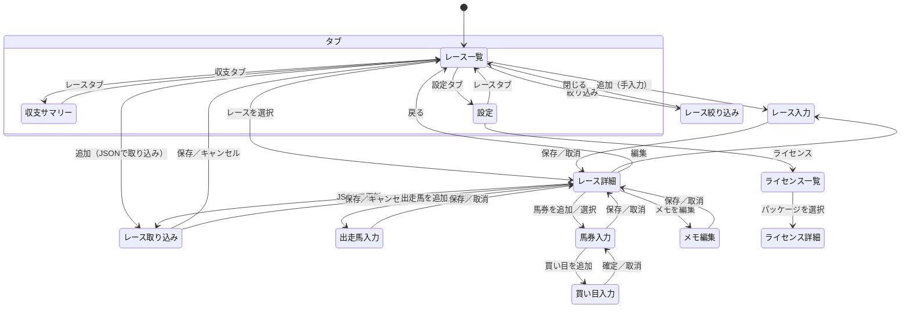
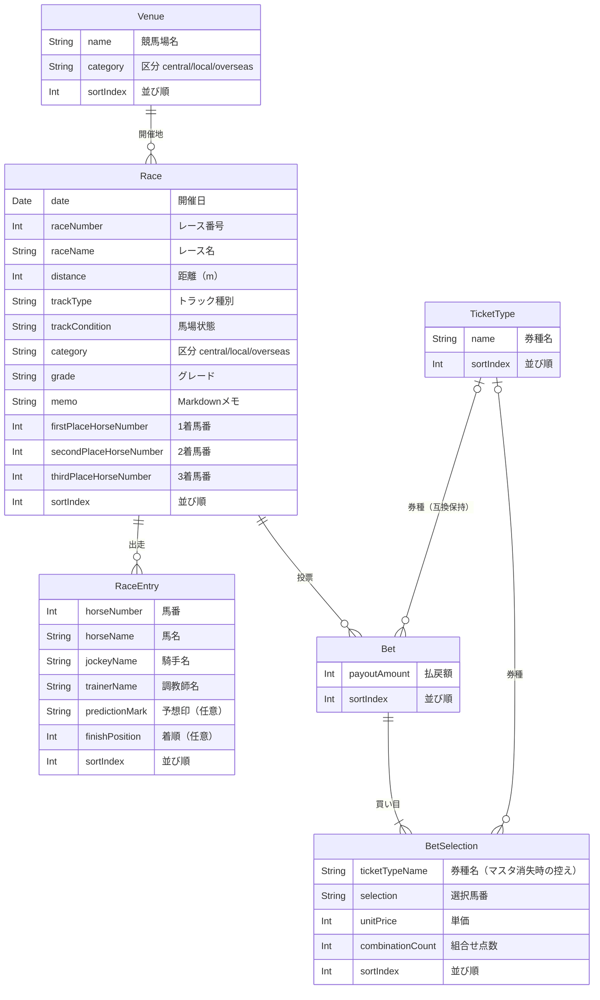

# 仕様

## 機能一覧

[requirements.md](requirements.md) の機能要件と、各詳細仕様を対応付けたもの。

| # | 機能 | 分解した内容 | 詳細を記す節 |
| :--- | :--- | :--- | :--- |
| 1 | レース記録の管理 | レース一覧の表示、登録、編集、削除、絞り込み（競馬場・区分・グレード・日付範囲） | [並び順と絞り込み](#並び順と絞り込み)、[削除と記録の一体性](#削除と記録の一体性)、[状態と遷移](#状態と遷移) |
| 2 | 出走馬・予想の記録 | 出走馬の追加・編集・削除、予想印の付与と解除、着順（1〜3着）の記録 | [予想印](#予想印)、[データ定義](#データ定義) |
| 3 | 馬券の記録 | 馬券の追加・編集・削除、買い目の追加、買い方の選択、組合せ点数と購入額の自動算出、払戻額の入力 | [組合せ点数](#組合せ点数)、[購入額・収支・回収率](#購入額収支回収率) |
| 4 | メモの記録 | レース単位の Markdown メモの編集と表示 | [画面・操作仕様](#画面操作仕様) |
| 5 | 収支の集計 | 日／月／年／任意期間の収支・回収率の表示 | [購入額・収支・回収率](#購入額収支回収率) |
| 6 | データの持ち出し | ZIP バックアップの書き出しと取り込み、CSV エクスポート | [ZIP バックアップ](#zip-バックアップ)、[CSV エクスポート](#csv-エクスポート) |
| 7 | マスタ | 競馬場はアプリが定める49場（中央10場・地方15場・海外24場）、券種はアプリが定める10種（単勝・複勝・枠連・馬連・ワイド・馬単・三連複・三連単・枠単・応援馬券）に固定し、編集画面は持たない | [データ定義](#データ定義) |
| 8 | 取り消し | 削除操作の退避と、シェイクによる復元 | [削除と取り消し](#削除と取り消し)、[削除と記録の一体性](#削除と記録の一体性) |
| 9 | ライセンス表示 | 利用しているオープンソースパッケージの一覧と本文表示 | [画面・操作仕様](#画面操作仕様) |
| 10 | レース取り込み | JSON テキストの貼り付けによるレース・出走馬の登録（一覧の + ›「JSONで取り込み」）と差分更新（詳細の編集 ›「JSONで更新」）、保存前の差分プレビュー、AI 向けプロンプトとエラー内容のコピー | [レースの取り込み](#レースの取り込み)、[レース取り込みの JSON](#レース取り込みの-json) |

## 業務ルール

### 組合せ点数

買い目の組合せ点数は、券種・買い方・選択馬番から決まる。券種ごとに数え方が異なり、同じ組を二重に数えない。

| 買い方 | 券種 | 組合せ点数 |
| :--- | :--- | :--- |
| 通常 | 応援馬券 | 2 点（1 頭の単勝と複勝を 1 枚で買うため） |
| 通常 | 上記以外 | 1 点 |
| BOX（n 頭） | 枠連・馬連・ワイド | n × (n − 1) ÷ 2 |
| BOX（n 頭） | 馬単・枠単 | n × (n − 1) |
| BOX（n 頭） | 三連複 | n × (n − 1) × (n − 2) ÷ 6（n が 3 未満なら 0 点） |
| BOX（n 頭） | 三連単 | n × (n − 1) × (n − 2)（n が 3 未満なら 0 点） |
| BOX | 上記以外の券種、または 2 頭未満 | 0 点 |
| フォーメーション | 枠連・馬連・ワイド（2 列）、三連複（3 列） | 各列から 1 頭ずつ選んだ組のうち、同じ馬番を含む組を除き、並び順だけが違う組は 1 点として数える |
| フォーメーション | 馬単・枠単（2 列）、三連単（3 列） | 各列から 1 頭ずつ選んだ組のうち、同じ馬番を含む組を除いた数。並び順が違えば別の点として数える |
| フォーメーション | 列の数が券種の頭数と合わない、または 1 列だけ | 0 点 |
| フォーメーション | 上記以外の券種 | 各列の頭数の積 |
| 流し | 枠連・馬連・ワイド・三連複 | 軸をすべて含み、残りを相手から選んだ組の数。着順の指定とマルチは無視する |
| 流し | 馬単・枠単・三連単（着順を指定） | 軸を指定した着順に置き、残りの着順を相手から選んだ組の数 |
| 流し | 馬単・枠単・三連単（着順を指定しない） | 軸を 1 着から順に置いたものとして数える |
| 流し | 馬単・枠単・三連単（マルチ） | 軸の着順のすべての置き方について数え、同じ組は 1 点として数える |
| 流し | 流しに対応しない券種（単勝・複勝・応援馬券など） | 0 点 |
| （共通） | 買い目が空 | 0 点 |

流しでは次のとおり扱う。

- 軸の頭数は、1 点あたりの頭数より少なくする（2 頭の券種は 1 頭、3 頭の券種は 1 頭または 2 頭）。それ以上の軸や、同じ馬番を重ねた軸は 0 点とする。
- 着順を区別する券種（馬単・枠単・三連単）では、券種の頭数を超える着順や、重複した着順の指定は 0 点とする。着順を区別しない券種では、着順の指定を無視するため点数に影響しない。
- 相手に軸と同じ馬番が含まれていても、その馬番は相手として数えない。相手の中で重複した馬番は 1 頭として数える。

### 購入額・収支・回収率

| 値 | 求め方 |
| :--- | :--- |
| 買い目の購入額 | 単価 × 組合せ点数 |
| 馬券の購入額 | 配下の買い目の購入額の合計 |
| 馬券の収支 | 払戻額 − 購入額 |
| レースの購入額・払戻額 | 配下の馬券の合計 |
| レースの収支 | 払戻額の合計 − 購入額の合計 |
| 回収率 | 払戻額の合計 ÷ 購入額の合計 |

| 条件 | 結果 |
| :--- | :--- |
| 払戻額が未入力の馬券 | 払戻 0 円として扱う |
| 購入額の合計が 0（馬券がない場合を含む） | 回収率は求めず、表示しない |
| 収支の集計対象 | レースの**開催日**が集計期間に含まれるレース。記録を作成した日時では集計しない |
| 集計期間 | 日・月・年、または開始日と終了日を指定した期間。期間は両端の日を含む |
| 期間の開始日が終了日より後 | 集計対象を 0 件とする |

### 並び順と絞り込み

| 対象 | 規則 |
| :--- | :--- |
| レース一覧の並び順 | 開催日で並べ、昇順・降順を切り替えられる（初期は新しい順）。同じ開催日の中はレース番号の昇順 |
| 絞り込み条件の組合せ | 競馬場・区分・グレード・日付範囲の各条件を AND で合成する |
| 未設定の条件 | 結果を狭めない。すべての条件が未設定なら全レースを返す |
| 絞り込みの結果 | 常に絞り込み前のレースの部分集合になる。並び順は変えない |
| 競馬場・グレードの複数選択 | 選択したいずれかに一致すれば合致する |
| 競馬場の条件があるときの、競馬場が未選択のレース | 合致しない |
| 日付範囲 | 開始日・終了日の両端の日を含む。片方だけの指定では、指定しない側を制限しない |

### 予想印

| 対象 | 規則 |
| :--- | :--- |
| 種類 | ◎（本命）・○（対抗）・▲（単穴）・△（連下）・☆（星）・注（注意）・押（押さえ）・消（消し）のちょうど 8 種 |
| 付け方 | 1 頭につき 1 つ。印なし（未設定）を許容し、付けた印は外せる |
| 保存・書き出し・取り込み | 8 種すべてについて、保存や書き出しを経て読み戻しても同じ印になる。印なしは印なしのまま保たれる |
| 8 種以外の値 | 印として扱わない（レース取り込みではエラーにする） |

### 削除と記録の一体性

| 操作・出来事 | 結果 |
| :--- | :--- |
| レースを削除する | そのレースの出走馬・馬券・買い目も削除される |
| 馬券を削除する | その馬券の買い目も削除される |
| 削除を取り消す | 削除した記録が、関連する子の記録ごと復元される |
| 競馬場・券種のマスタが失われる | それを参照していた記録は残り、参照だけが外れる。券種名は記録側の控えで表示・集計・書き出しを続ける。競馬場は控えを持たないため、レースは競馬場が未選択の状態になる |
| データを初期化する | レース・出走馬・馬券・買い目をすべて削除する。競馬場・券種のマスタは変えない。取り消せない |

競馬場・券種はアプリが定める固定リストで、利用者が削除する経路はない。

### レースの取り込み

JSON の貼り付けによる取り込みは、**追加**（レース一覧から）と**更新**（レース詳細から）を入口で分け、混ぜない。AI の出力がぶれても、別のレースに紐づいたり二重登録されたりしないようにするため。JSON の形式は [レース取り込みの JSON](#レース取り込みの-json) を参照。

| 条件 | 結果 |
| :--- | :--- |
| 追加で、開催日・競馬場名・R番号が同じレースがまだない | レースと JSON の出走馬すべてを新規登録する。区分は競馬場から決める |
| 追加で、開催日・競馬場名・R番号が同じレースが既にある | エラーにし、詳細の「JSONで更新」へ案内して、何も保存しない。開催日は時刻を無視して同じ日付かどうかで比べる |
| 更新 | 開いているレースだけを更新する。JSON の `date` / `venue` / `raceNumber` は検証するが使わず、レースの開催日・競馬場・R番号・区分は変えない |
| 更新で、JSON と値が違うレースの項目 | その項目だけを更新する |
| 更新で、レースに同じ馬番の出走馬がある | 値が変わった項目だけを更新する |
| 更新で、レースにない馬番が JSON にある | 出走馬を追加する |
| 更新で、レースにある馬番が JSON にない | その出走馬を削除する |
| 更新での馬券 | 変えない。馬券は出走馬への参照ではなく馬番を持つため、出走馬を削除しても残る |
| メモ | 取り込みでは変えない。JSON にメモを含めず、アプリ内で書いたメモを上書きしない |
| 省略されたフィールド、`null`、型違い、使えない値 | エラーにし、何も保存しない。不正な値はすべて集めてから中止し、原因のフィールドを `entries[0].mark` の形で示す |
| 取り込んでも何も変わらない | 「変更はありません」を表示し、保存できない |

保存は、差分をプレビューして利用者が確定したときの 1 回だけ行う。確定するまで記録は変わらない。

貼り付けたテキストは次のように読む。

- 最初の `{` から最後の `}` までを JSON とみなし、コードフェンスや前後の説明文を取り除く。
- 入力中に変換された全角の引用符（“ ”）は `"` に戻す。

## 画面・操作仕様

3つのタブを起点とする。

| 画面 | 役割 | 主な入出力項目 |
| :--- | :--- | :--- |
| レース一覧 | ホーム。登録済みレースを開催日順に並べる | 出力: 開催日・競馬場・R番号・レース名・収支。操作: 追加（+ メニューから手入力またはJSONで取り込み）、絞り込み、スワイプ削除 |
| レース絞り込み | 一覧の絞り込み条件を設定するシート | 入力: 区分（中央／地方／海外）・グレード（複数選択）・開始日・終了日・競馬場（区分ごとに見出しを付けた複数選択） |
| レース詳細 | 1レースの全記録を集約して表示 | 出力: レース情報・出走馬一覧・馬券一覧・メモ・収支。操作: 各記録の追加と編集、編集メニューからのJSONで更新 |
| レース入力 | レースの登録・編集シート | 入力: 開催日・競馬場（区分ごとに見出しを付けた一覧から選択）・R番号・レース名・グレード・距離・トラック種別・馬場状態・着順（1〜3着）。出力: 区分（競馬場から決まる） |
| 出走馬入力 | 出走馬の登録・編集シート | 入力: 馬番・馬名・騎手・調教師・予想印・着順 |
| 馬券入力 | 馬券の登録・編集シート | 入力: 買い目リスト・払戻額。出力: 組合せ点数・購入額 |
| 買い目入力 | 買い目1件の入力シート | 入力: 券種（アプリが定める券種から選択）・買い方・選択馬番・単価 |
| メモ編集 | Markdown メモの編集シート | 入力: メモ本文 |
| 収支サマリー | 期間別の収支を集計して表示 | 入力: 集計期間の選択。出力: 購入合計・払戻合計・収支・回収率 |
| 設定 | データ管理 | 操作: ZIP 書き出し／取り込み、CSV 書き出し、データ初期化 |
| レース取り込み | JSON を検証し、差分を確認してから保存するシート。一覧から開くと新規登録だけを行い、詳細から開くとそのレースを更新する（JSON の日付・競馬場・R番号は使わない） | 入力: JSON テキスト。出力: レース・出走馬ごとの新規作成／更新／変更なし／削除と変更前後の値、エラーの原因フィールド。操作: AI 向けプロンプトのコピー、エラー内容のコピー、確認、保存 |
| ライセンス一覧／詳細 | 依存パッケージのライセンス表示 | 出力: パッケージ名、ライセンス本文 |

入力チェックは各入力画面で行い、必須項目が欠けている場合は保存操作を無効化する。

### レース取り込みの入口

入口はレース一覧の + メニュー（「JSONで取り込み」）と、レース詳細の編集メニュー（「JSONで更新」）の 2 か所とする。レースを足すときと予想を見直すときの操作の流れに置くため、設定画面には置かない。どちらの入口から開いたかで追加か更新かが決まり、シートの中で切り替えることはない（[レースの取り込み](#レースの取り込み)）。

### 削除と取り消し

削除は即座に確定させず、取り消しの余地を残す。

| 操作 | 条件 | 結果 |
| :--- | :--- | :--- |
| レース・出走馬・馬券を削除する | — | 記録と関連する子の記録を削除し、一覧から消す。削除した内容は取り消しのために退避される |
| デバイスを振る | 取り消せる操作がある | 取り消しの確認を提示する |
| デバイスを振る | 取り消せる操作がない | 確認を提示せず、何も起こさない |
| 確認で取り消しを承認する | — | 退避した記録を復元し、一覧に戻す |
| 確認を拒否する | — | 何も復元しない。退避した記録は保持され、再度デバイスを振れば取り消せる |

取り消せなくなる条件は [状態と遷移](#状態と遷移) を参照。

### 画面遷移

## 状態と遷移

レース記録は、操作を制限する状態を持たない。記録がどこまで埋まっているか（記録開始・予想確定・結果記録済み・収支確定）は [requirements.md](requirements.md) の「記録の段階」にある説明上の呼び名で、データとして保持せず、入力の順序や編集の可否を決めない。

| 観点 | 規則 |
| :--- | :--- |
| 入力の順序 | 自由。出走馬・予想・馬券・着順・払戻のどれからでも入力でき、前の項目が埋まっていることを条件にしない |
| 後からの修正 | 予想・結果・払戻は、いつでも追記・修正できる。確定して編集できなくなる状態はない |
| 中間状態の表示 | 一部だけが入力された記録も、画面は破綻せずに表示できなければならない。例: 着順だけを先に入力し、出走馬が未登録のままのレース |
| 削除 | 記録がどこまで埋まっていても削除でき、取り消しで削除前の内容に戻せる |
| 削除した記録 | 取り消しを経ずに再び現れることはない |

削除した記録を取り消しで戻せるかどうかは、次のとおり決まる。

| 出来事 | 取り消し |
| :--- | :--- |
| レース・出走馬・馬券を削除した | 取り消せる |
| 取り消しの確認を拒否した | 取り消せるまま（退避した記録を保持し、再度デバイスを振ったときに確認を提示する） |
| ZIP の取り込みに成功した | それより前の操作は取り消せなくなる（取り込みは記録をすべて置き換えるので、古い操作を戻すと置き換えたデータに混ざる） |
| ZIP の取り込みに失敗した | 取り込み前の操作は取り消せるまま |
| データを初期化した | 初期化そのものは取り消せない。それより前の操作も取り消せなくなる（初期化は記録をすべて消すので、古い操作を戻すと、空にしたデータに古い記録が戻る） |

## データ定義

レースを中心に、出走馬と馬券がぶら下がる。競馬場と券種はマスタとして参照される。

**関連の強さ**

- レースと出走馬・馬券、馬券と買い目は、親と一体の記録である。親を消せば子も消える。
- 競馬場・券種と記録の間は参照である。片方が失われても、もう片方は独立して残る。

削除したときの結果は [削除と記録の一体性](#削除と記録の一体性) を参照。

**項目定義の補足**

| 項目 | 定義 |
| :--- | :--- |
| `category` | `central`（中央）・`local`（地方）・`overseas`（海外）のいずれか。`Race` の区分はレース入力で選んだ競馬場（`Venue`）の区分を保存したもの。競馬場が未選択なら新規は中央、編集時は元の区分のまま |
| `grade` | 未選択 / `G1` / `G2` / `G3` / `Listed`（リステッド）/ `OpenSpecial`（オープン特別）/ `General`（一般） |
| `predictionMark` | ◎ ○ ▲ △ ☆ 注 押 消 の8種。未設定（印なし）を許容する。意味は [予想印](#予想印) を参照 |
| `selection` | 買い方ごとの書式。通常 `1-2-3`、BOX `1,2,3[BOX]`、フォーメーション `1,2/3,4,5`（軸を `/` で区切る）、流し `<軸>><相手>[<種別>]`。流しの種別は `流し`（着順を問わない）、`<着順>着流し`（例: `1着流し`、軸2頭は `1・3着流し` で軸の並び順に対応）、`流しマルチ` のいずれか。出走馬未登録時はこの書式で直接入力する |
| `trackType` | `turf`（芝）または `dirt`（ダート） |
| `trackCondition` | 良 / 稍重 / 重 / 不良 |
| 着順の馬番（`firstPlaceHorseNumber` など） | 1〜3 着の馬番。未確定は 0 |
| 購入額・収支・回収率 | 保持しない。買い目の単価と組合せ点数、および払戻額から都度導出する（[購入額・収支・回収率](#購入額収支回収率)） |
| `ticketTypeName` | マスタ（`TicketType`）が削除されても券種名が読めるよう、記録側に控えを持つ |

券種名を自由入力する「カスタム券種」は廃止した。廃止前に登録された買い目（`ticketType` が nil、またはアプリが定めない券種を参照）は `ticketTypeName` で表示・集計・書き出しを続け、編集時も券種を選び直さない限りそのまま保存される。起動時に券種マスタへ足りない券種を末尾に追加し、既存の券種と並び順は変えない。応援馬券は 1 頭の単勝と複勝を 1 枚で買う券種で、買い目 1 件を 2 点（単価 × 2）として数える。

競馬場の追加・削除・リセットを行う管理画面は廃止した。起動時に競馬場マスタへ足りない競馬場を末尾に追加し、既存の競馬場と並び順・レースとの紐づきは変えない。既存の競馬場の区分はアプリが定める区分に揃える。

`Bet` 側の券種・買い目・単価は、買い目を `BetSelection` へ分離する前の形式で保存された記録を読むために残している。新規の記録は `BetSelection` 側に持つ。

## 入出力・外部連携仕様

アプリは通信を行わない。外部とのやり取りは、利用者が貼り付けるテキストと、利用者が選んだ場所へ読み書きするファイルだけである。

### レース取り込みの JSON

`schemaVersion` は 1。1 回の貼り付けで 1 レースを扱う。すべてのフィールドが必須で、省略・`null` は認めない。

| フィールド | 値 |
| :--- | :--- |
| `schemaVersion` | `1` のみ |
| `race.date` | `yyyy-MM-dd`（端末のタイムゾーンでその日の 0 時として扱う） |
| `race.venue` | アプリが定める 49 場の名前 |
| `race.raceNumber` | 1〜12 |
| `race.raceName` | 文字列（空文字可） |
| `race.distance` | 1 以上の整数（メートル） |
| `race.trackType` | `turf` / `dirt` |
| `race.trackCondition` | 良 / 稍重 / 重 / 不良 |
| `race.grade` | `grade` の値（`G1` / `G2` / `G3` / `Listed` / `OpenSpecial` / `General`）。空文字は未選択 |
| `race.firstPlaceHorseNumber` 〜 `thirdPlaceHorseNumber` | 着順の馬番。0 は未確定。0 以外は `entries` にあり、互いに重複しない |
| `entries[].horseNumber` | 1 以上、レース内で重複しない |
| `entries[].horseName` | 文字列（空文字不可） |
| `entries[].jockeyName` / `trainerName` | 文字列（空文字可） |
| `entries[].mark` | 8 種の予想印、または空文字（印なし） |

メモはスキーマに含めない（アプリ内で書いたメモを取り込みで上書きしないため）。取り込んだときに何が登録・更新・削除されるかは [レースの取り込み](#レースの取り込み) を参照。

### AI 向けプロンプト

「AI 向けプロンプトをコピー」は、次の 3 つをまとめてコピーする。

| 内容 | 役割 |
| :--- | :--- |
| 出力のルール（指示文） | JSON Schema だけでは伝えきれない約束を伝える。「着順の馬番は `entries` にある」「JSON に無い馬は削除される」など |
| JSON Schema（draft 2020-12） | フィールドの型と、競馬場・印・グレード・馬場状態の選択肢を AI に伝える。選択肢はアプリが受け付ける値と一致する |
| 出力例 | 形式の例を示す |

取り込めるかどうかはアプリの検証で決まり、JSON Schema は AI への説明として使う。

### ZIP バックアップ

復元を目的とした書き出し。次のファイルを UTF-8 で書く。

| ファイル | 内容 | 列 |
| :--- | :--- | :--- |
| `races.csv` | レース | `date`, `venue`, `race_number`, `race_name`, `distance`, `track_type`, `track_condition`, `category`, `grade`, `first_place_horse`, `second_place_horse`, `third_place_horse`, `total_purchase`, `total_payout`, `balance` |
| `entries.csv` | 出走馬 | `date`, `venue`, `race_number`, `horse_number`, `horse_name`, `jockey_name`, `trainer_name`, `prediction_mark` |
| `bets.csv` | 馬券 | `date`, `venue`, `race_number`, `bet_sort_index`, `purchase_amount`, `payout_amount`, `balance` |
| `bet_selections.csv` | 買い目 | `date`, `venue`, `race_number`, `bet_sort_index`, `ticket_type`, `selection`, `unit_price`, `combination_count`, `sort_index` |
| `memo/<名前>.md` | メモが空でないレースのメモ（1 レース 1 ファイル） | Markdown の本文 |

| 項目 | 規則 |
| :--- | :--- |
| レースとの対応付け | 出走馬・馬券は `date`・`venue`・`race_number` でレースに、買い目はさらに `bet_sort_index` で馬券に対応付ける |
| `track_type` / `category` | 表示名で書く（芝／ダート、中央／地方／海外） |
| 着順の馬番 | 未確定は空欄 |
| メモのファイル名 | `<yyyyMMdd>_<競馬場>_R<レース番号>_<レース名>.md`。競馬場・レース名が空なら、その部分を省く。`/` `:` `\` は `_` に置き換える。競馬場とレース番号を含めるのは、同じ日の同じ名前のレースが別の競馬場にあっても、互いのメモを上書きしないため |
| マスタ | 競馬場・券種のマスタは書き出さない。取り込み時は、取り込み先の端末のマスタへ名前で結び直す。同じ名前のマスタがない券種は、券種名の控えだけを持つ買い目として取り込む。同じ名前のマスタがない競馬場のレースは、競馬場が未選択のレースとして取り込み、区分は `category` 列の値を使う |
| 取り込みの範囲 | 既存のレース・出走馬・馬券・買い目をすべて置き換える。競馬場・券種のマスタは変えない |
| 取り込みの失敗 | どの段階で失敗しても、既存の記録は取り込み前のまま残る。失敗の条件と表示は [エラー・通知仕様](#エラー通知仕様) を参照 |

**旧形式の読み取り**

以前のアプリが書き出したバックアップも取り込める。

| 旧形式 | 読み方 |
| :--- | :--- |
| `races.csv` に `grade` 列や着順の列がない | グレードは未選択、着順は未確定として取り込む |
| `bet_selections.csv` がなく、`bets.csv` が券種・買い目を直接持つ | 馬券 1 件につき買い目 1 件を作って取り込む |
| メモのファイル名が `<yyyyMMdd>_<レース名>.md`（レース名が空なら `<yyyyMMdd>_R<レース番号>.md`） | 開催日とレース名（またはレース番号）が合うレースのメモとして読む。合うレースが複数あるときは、`races.csv` で先にある行のレースのメモにする。利用者の手元にある既存のバックアップを読めなくしないため、この読み方は残す |

### CSV エクスポート

他のアプリへの移行や閲覧を目的とした書き出し。ZIP バックアップと同じ列の 4 つの表を、`=== RACES ===`・`=== ENTRIES ===`・`=== BETS ===`・`=== BET_SELECTIONS ===` の見出しで区切って 1 つのテキストにまとめる。メモはレースの表の `memo` 列に書き、改行は空白に置き換える。CSV エクスポートからは記録を復元できない。

### ファイルの日付

ZIP バックアップと CSV の日付は、端末の暦法にかかわらず西暦で書く（`date` 列は `yyyy/MM/dd`、メモファイル名は `yyyyMMdd`）。西暦で書くようにする前のアプリで、暦法を和暦にした端末から書き出したバックアップは元号の年だけが書かれている（2026/10/31 が `0008/10/31`）。元号が分からず西暦に戻せないため非対応とし、書かれた年を西暦の年としてそのまま読む。端末内の記録は正しい日付のままなので、今のアプリで書き出し直せば西暦のバックアップになる（オーナー決定、2026-11-06）。

## エラー・通知仕様

| 場面 | 条件 | 文面の要旨 |
| :--- | :--- | :--- |
| 削除の取り消し | シェイク検知時に取り消せる操作がある | 「〈操作名〉を取り消しますか？」／取り消す・キャンセル |
| 削除の取り消し | 取り消せる操作の名前が取得できない | 「最後の操作を取り消しますか？」 |
| 削除の取り消し | シェイク検知時に取り消せる操作がない | 何も表示しない |
| レース一覧 | 絞り込み条件に合致するレースが0件 | 「条件に一致するレースがありません」 |
| ZIP 取り込み | 取り込みを実行すると既存レースが置き換わる | 置換される旨を提示し、承認を求める |
| ZIP 取り込み | `races.csv` に `yyyy/MM/dd` として読めない日付がある | 最初の 1 件の行番号と値を示し、何も変更しない |
| ZIP 取り込み | `races.csv` に、列が 8 列（date〜category）に足りない行がある（空行は除く） | 最初の 1 件の行番号を示し、何も変更しない |
| ZIP 取り込み | `races.csv`・`entries.csv`・`bets.csv`・`bet_selections.csv`（ある場合）のどれかが UTF-8 として読めない | 読めないファイル名を示し、文字コードが UTF-8 でないかファイルが壊れている旨を伝えて、何も変更しない。原因は限定しない: 読めない原因にはファイルの破損もあり、保存し直せば直るとは限らないため。`memo/` のメモが読めないときは、そのメモだけを飛ばして取り込む |
| ZIP 取り込み | 上の CSV のどれかの中身が、ZIP に記録された CRC と合わない | 展開のエラーを示し、何も変更しない。アプリの書き出しは無圧縮なので、中身が壊れても UTF-8 として読めることがあり、CRC を照合しないと壊れた値を黙って取り込んでしまうため。メモは照合せず、読めるものを取り込む |
| ZIP 取り込み | CSV はすべて読めたが、既存データを消したあとで失敗した | エラーを示し、何も変更しない（取り込みの前から保存待ちだった変更は保存される） |
| 削除の取り消し | ZIP 取り込みに成功したあとでシェイクした | 取り込み前の操作は取り消せない（取り込みは記録をすべて置き換えるので、古い操作を戻すと置き換えたデータに混ざる） |
| レース取り込み | JSON の構文エラー、必須フィールドの省略・`null`、型違い、使えない値（競馬場・印・グレード等） | 原因のフィールド（例: `entries[0].mark`）と使える値を一覧し、何も保存しない。AI に渡して直してもらうための文面をコピーできる |
| レース取り込み | 一覧から開き、日付・競馬場・R番号が同じレースが既にある JSON を貼った | 既に登録されている旨と、詳細の「JSONで更新」を使う案内を示し、何も保存しない |
| レース取り込み | 取り込んでも何も変わらない | 「変更はありません」を表示し、保存操作を無効化する |
| データ初期化 | 全記録を削除する | 取り消せない旨を提示し、承認を求める |
| 削除の取り消し | データ初期化のあとでシェイクした | 初期化より前の操作は取り消せない |

外部連携を行わないため、通信・認証に関するエラーは存在しない（[architecture.md](architecture.md) の不変条件を参照）。
