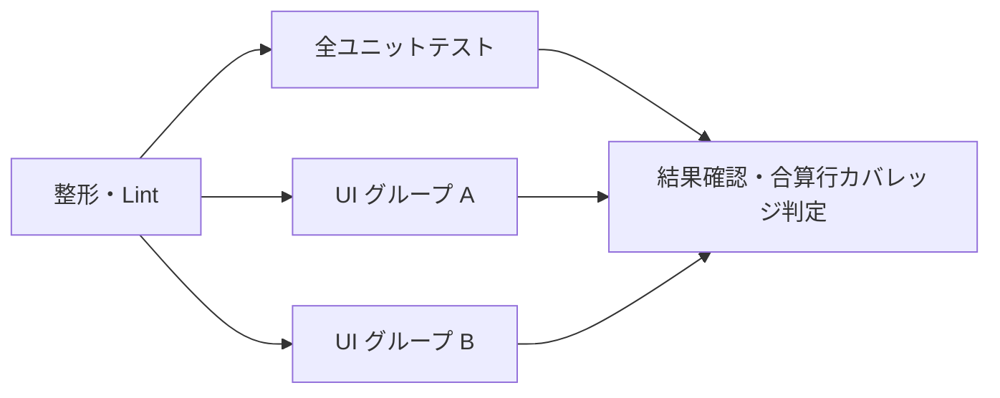

# テスト計画

この文書は、何をどこまで、どの環境・基準で検証するかを決める。受け入れ基準と非機能目標は [requirements.md](requirements.md)、期待動作は [specification.md](specification.md)、構造上の制約は [architecture.md](architecture.md) を正とし、ここでは重ねて定義しない。テストケースと手順はテストコードを正とし、文書にしない。実行コマンドは [AGENTS.md](../AGENTS.md#commands)、CI の実行可能な定義は [ios-quality.yml](../.github/workflows/ios-quality.yml) を正とする。

## テストスコープ

| 対象 | 範囲 | 自動テスト |
| :--- | :--- | :--- |
| ドメインモデル（`Models/`） | 組合せ点数・購入額・収支・回収率の導出、絞り込み、予想印、マスタ、取り消しの退避と復元 | `umalogTests` |
| 入出力（`Utils/`） | ZIP バックアップの書き出しと取り込み（旧形式・失敗時の保全を含む）、CSV エクスポート、レース取り込みの JSON、ファイルの日付 | `umalogTests` |
| 画面（`Views/`） | 業務の流れに沿った画面操作と、画面・保存の結線 | `umalogUITests` |
| シェイク検知（UIKit） | シェイクから取り消しの確認を出すまでの結線 | 自動化できない（[検証限界](#検証限界)） |

対象外とするもの:

- **依存パッケージの内部動作**（swift-markdown-ui、ZIPFoundation など）。アプリから使う範囲（Markdown メモの表示、ZIP の読み書き）だけを、アプリのテストを通して確かめる。
- **OS が提供する画面の内部**（ドキュメントピッカー、共有シート）。アプリがそれを開き、選ばれた結果を処理する部分までを対象にする。
- **App Store の配信・審査**。配信地域・年齢レーティング・説明文の記載は、申請時に人が確認する。
- **まだ提供していない機能**（iCloud 同期など、[requirements.md](requirements.md) の「スコープ外」）。

## テストレベルと使用ツール

| 設計 | 検証 | ツール・手段 |
| :--- | :--- | :--- |
| [requirements.md](requirements.md) の業務要件 | シナリオテスト（システムが担う部分）と受け入れテスト（人を含む業務全体） | シナリオテストは XCUITest（`umalogUITests`）。機能単位の UI テストは設けず、業務シナリオの中に各機能の利用を含めて確かめる。受け入れテストは実機・Simulator での操作で、GO / NO-GO はオーナーが判断する |
| [requirements.md](requirements.md) の非機能要件 | 非機能目標を合否条件とする検証 | 下の「非機能要件の検証」を参照 |
| [specification.md](specification.md) | インテグレーションテスト | Swift Testing（`umalogTests`）。インメモリの `ModelContainer` で SwiftData まで結合し、ブラックボックスで確かめる。入出力・画面・保存を介さずに入力から結果が決まる業務ルール（組合せ点数、収支、絞り込みなど）は、業務ルールの表の行に対応づけたユニットテストでも確かめる |
| [architecture.md](architecture.md) | 構造による強制とレビュー | 単一ターゲット構成のため、層間の依存方向はビルドで強制できない。PR レビュー（AI を含む）で [architecture.md](architecture.md) と照合する。整形と Lint（SwiftFormat・SwiftLint）は CI で強制する |
| 詳細設計（文書にしない） | ユニットテスト | Swift Testing（`umalogTests`） |
| ユニットテスト自体の妥当性 | レビューと、テストが仕様を押さえているかの確認 | PR レビューで仕様の表と突き合わせる。ミューテーションテストは使えない（[品質ゲートと基準](#品質ゲートと基準)） |

テスト関数名は、何を確かめるかを日本語の仕様文で書く（例: `払戻が購入より多い場合に収支がプラスになる()`）。このため SwiftLint の `identifier_name` を無効にしている。テストに Issue 番号や受け入れ基準の番号を書かない。番号だけでは何を確かめるかが分からず、別の Issue の番号と衝突するため。

### 非機能要件の検証

| 非機能要件 | 合否の確かめ方 |
| :--- | :--- |
| プライバシー | ネットワーク通信を行うコード・SDK を追加していないことを、PR レビューで差分と依存パッケージから確かめる |
| 可用性（オフライン） | 通信を行うコードがないことを、プライバシーと同じ PR レビューで確かめる |
| 費用 | 課金による分岐がないことを PR レビューで確かめる |
| 対応範囲 | 中央・地方・海外の競馬場マスタが揃うことをユニットテストで確かめる |
| データ保全 | ZIP の往復と旧形式の読み取り、取り込み失敗時に既存の記録が残ることを、インテグレーションテストとシナリオテストで確かめる。内部表現を変える PR では、旧形式のデータを読めることを確かめるテストを伴わせる |
| 操作の安全性 | 削除の退避と復元をユニットテストで確かめる。シェイクで取り消しを呼び出す部分は Simulator での手動確認で確かめる |
| 配信 | App Store への申請時に、配信地域・年齢レーティング・説明文と App Review Notes の記載を人が確かめる |

## テスト環境と外部境界

### 実行環境

| 環境 | 役割 |
| :--- | :--- |
| ローカル（M5 Mac） | 実装中のビルド、変更に関連するテスト、新しい UI テストの反復実行、Simulator での操作確認 |
| GitHub Actions（`xcode-27` ランナー） | 独立した環境での全件検証（整形・Lint、全ユニットテスト、全 UI テスト、合算カバレッジ） |
| 実機 | 受け入れテスト |

どの環境でも、Xcode 27.1 と `iPhone 18 Pro`・iOS 27.0 の Simulator で実行する。deployment target（iOS 27.0）より古い runtime ではアプリを起動できないため。テスト計画（`umalog.xctestplan`）は M5 Mac に合わせて並列実行を有効にしており、ローカルの UI テストのワーカー数は 5 とする。CI のワーカー数はローカルとは独立に決める。

### GitHub Actions による全件検証

全件検証の待ち時間と重複実行を抑えるため、Draft PR の間は実行しない。PR が Ready for review の状態にあるときだけ自動で起動し（Ready for review にしたとき、最初から Ready for review で作ったとき、Ready for review の PR を開き直したとき、Ready for review の PR に push したとき）、オーナーがレビューを始める時点で、最新の内容に対する結果が揃うようにする。同じ PR で新しい実行が始まったとき、PR を Draft に戻したとき、PR を閉じた（マージした）ときは、実行中のものを取り消す。それ以外の確認（部分再実行、PR を作る前の確認）は手動で起動する。

整形・Lint が成功してから、ユニットテストと 2 グループの UI テストを別々のランナーで並列実行する。各ランナーでビルドを行い、UI テストはランナー内では並列にしない。

- **UI の分配はクラス単位の実測時間を基準とする。** 両グループの終了時刻を近づけることで待ち時間を短くする。A を指定したクラス、B をその補集合とし、全 UI テストを漏れ・重複なく分配する。追加したクラスは B に入るため、テストの追加や実行時間の変化に応じて負荷を見直す。
- **待ち時間とランナーの合計利用時間を分けて評価する。** 別ランナーでの並列実行はビルドや環境準備が重複するため、待ち時間が縮んでも計算資源が減るとは限らない。
- **1 グループの失敗で他のグループを打ち切らない。** 生成したテスト結果とログをグループごとに保存し、失敗の調査に使う。部分再実行では、再実行したグループの成果物だけを置き換え、他グループの成功結果を引き継ぐ。合算ジョブは、いずれかのテストが失敗した場合にも結果を確認し、ジョブの失敗を過去の成功結果で合格にしない。
- フォークからの PR では実行しない。外部のコードを `xcode-27` ランナーで動かさないため。

実行方法・所要時間・分配調整時の注意は [AGENTS.md](../AGENTS.md#github-actions) を参照する。

### テストデータ

- **インテグレーションテスト・ユニットテスト**: テストごとにインメモリの `ModelContainer` を作り、端末のストアを使わない。
- **シナリオテスト**: アプリを `--UITesting` で起動し、インメモリのストアを使う。共有の `iPhone 18 Pro` Simulator にはオーナーの実データがあるため、手動の操作確認でも `--UITesting` を付けて起動し、実データの上で保存しない。
- **ファイル**: ZIP・CSV はテスト用の一時ディレクトリに書き、実際のファイルを読み書きする。
- **暦法・ロケール**: プロセスの中から `Locale.current` を変えられないため、ユニットテストは Simulator の暦法で動く。暦法に依存する動作（ファイルの日付を西暦で書くこと）は、シナリオテストからアプリを `-AppleLocale` 付きで起動し直して確かめる。

### 外部境界

アプリは通信を行わないため、外部サービスに接続するテスト・テスト用のサンドボックス・資格情報はない。外部とのやり取りは、利用者が貼り付けるテキストと、利用者が選んだ場所へのファイルの読み書きだけである。

| 境界 | 扱い |
| :--- | :--- |
| 貼り付けるテキスト（レース取り込みの JSON） | 本物を使う。シナリオテストではクリップボードに置いて貼り付ける |
| ファイルの読み書き | 本物のファイルを使う |
| システムのドキュメントピッカー | シナリオテストは開いてキャンセルするまでとし、往復は `--UITestingSkipDocumentPicker` でピッカーを飛ばして確かめる。選んだ後の処理はインテグレーションテストで確かめる。理由と限界は [検証限界](#検証限界) を参照 |

システムの境界の内側（SwiftData・入出力・画面）では、テストダブルを使わない。

## 品質ゲートと基準

| 検証 | 合格の基準 | 実行 |
| :--- | :--- | :--- |
| 整形 | SwiftFormat の `--lint` で差分がない | 必須（CI） |
| Lint | SwiftLint を `--strict` で実行して違反がない（警告も不合格）。規則は [.swiftlint.yml](../.swiftlint.yml) を正とする | 必須（CI） |
| ビルド | ビルドが成功する。言語モードは Swift 5 のため、並行性の誤りはビルドの成功だけでは検出されない | 必須（CI） |
| テスト | 全ユニットテストと全 UI テストが成功する。各グループに実行結果があり、テスト件数が正、失敗・スキップが 0 | 必須（CI） |
| カバレッジ | シナリオテストを除いたテストで、`umalog.app` の行カバレッジ 85% 以上 | 必須（CI） |
| ミューテーションテスト | Muter が現行の Xcode で動かないため実施しない | 対象外 |
| プロパティベーステスト | SwiftCheck が現行の Swift に対応するまで導入しない（オーナー決定） | 対象外 |
| 静的解析（CodeQL） | CodeQL がこのプロジェクトの Swift のバージョンに対応していないため実施しない。対応したら導入する | 対象外 |
| Sanitizer | 必須にしない。ZIP の展開などメモリの扱いに関わる変更では Address Sanitizer を有効にしてテストを実行する。計測が効いていることは、ASan のランタイムが `umalog.app` 内の `umalog.debug.dylib` にリンクされていることで確かめる | 該当する変更のとき |
| 依存脆弱性監査 | 依存パッケージを追加・更新する PR で、そのパッケージのリリースノートと GitHub Security Advisories を確かめる。CI は `Package.resolved` で固定した版だけを使う | 依存を変える PR のとき |

カバレッジは次のように扱う。

- シナリオテストは業務要件と突き合わせる手順を優先し、カバレッジ計測には含めない。
- 指標は行カバレッジである。`xccov` はブランチカバレッジを計測できない。
- 複数の結果を合算するときは xcresult を合算して求め、個別の率を足したり平均したりしない。個別の計測が 0/0 のとき、対象が欠けている・重複しているとき、行数が不正なときは不合格とする。
- シェイクによる取り消しのクロージャは、XCUITest で駆動できないためカバレッジの対象外として扱う。

承認済みの例外はない。基準を下げる・検証を対象外にするときは、オーナーの決定をこの表に書く。

## 終了条件

### 実装 PR を Ready for review にする条件

- ローカルで整形・Lint を通し、ビルドと変更に関連するテストが成功している。
- 新しい UI テストを `-test-iterations 5 -parallel-testing-worker-count 5` で実行し、すべて成功している。1 回の成功は信用しない。
- 新しく押せる操作要素を追加した場合は、その操作を含むシナリオテストか、実機・Simulator での操作確認がある。値型のユニットテストだけでは画面の結線を確かめられないため。
- 編集の流れは、保存した記録を開き直して操作するテストで確かめている。入力途中の下書きの上で確かめると、保存後に開き直したときだけ起きる不具合を見逃すため。
- 確かめられなかった範囲を、理由とともに PR 本文に書いている。

### マージ・受け入れテストへ進む条件

- GitHub Actions の全件検証が、最新の push に対して合格している。
- 受け入れテストでは、実行と証拠集め（操作ログ、スクリーンショット、録画）を AI に任せてよい。GO / NO-GO はオーナーが判断する。

## 重点リスクと検証限界

### 重点リスク

変更のときに重点的に確かめる観点。期待動作は [specification.md](specification.md) の「業務ルール」を正とし、ここには壊れやすい点を残す。テストケースの一覧ではない。

| 対象 | 壊れやすい点 |
| :--- | :--- |
| 組合せ点数 | 券種ごとに数え方が異なる。BOX・フォーメーション・流しで、重複した組合せを二重に数える（流しは相手に軸が含まれる場合や、マルチの並べ替えで同じ組が生じる場合） |
| 収支集計 | 集計がレースの**開催日**基準でなくなる。払戻未入力が 0 円として扱われなくなる |
| 回収率 | 購入額が 0 のときに破綻する |
| 絞り込み | 各条件が AND で合成されなくなる。未設定の条件が結果を狭める。結果が入力の部分集合でなくなる |
| 予想印 | 8 種のいずれかが往復変換で別の値になる。未設定（印なし）を維持できない |
| バックアップ | 書き出したファイルから記録を復元できない。旧形式のファイル名を読めなくなる。取り込みに失敗したときに既存の記録が失われる |
| ファイルの日付 | 和暦・仏暦の端末で、西暦以外の年が書かれる |
| 削除と取り消し | 削除した記録が、関連する子ごと復元されない |
| レース取り込み | 省略・`null`・不正な値で原因のフィールドが示されない、または何かが保存される。一覧からの取り込みが登録済みのレースを更新してしまう。詳細からの取り込みが JSON の日付・競馬場・R番号に引きずられて別のレースを変える。差分（更新・追加・削除）以外が変わる |
| 挿入直後の記録 | 挿入した記録の仮 ID が自動保存で本 ID に切り替わり、一覧の行やシートが作り直される。テストではタイミングによって失敗するため、不安定なテストに見えやすい |
| 画面の結線 | 新設した操作要素が実際のタップ・入力に反応しない。値型のテストでは検出できない |

不安定に見える UI テストの失敗は、xcresult（UI 階層、クラッシュログ、画面録画）でアプリの状態が正しかったかを確かめてから、Simulator の不安定さと判断する。挿入直後の記録の不具合は、不安定なテストに見えたことがあるため。

### 検証限界

- **シェイクによる取り消し**: XCUITest にシェイクを駆動する API がないため、自動では確かめられない。Simulator のシェイク通知（`notifyutil -p com.apple.UIKit.SimulatorShake`）で手動確認する。
- **システムのドキュメントピッカー**: 並列実行のクローン上ではファイルを選ぶ操作が効かず、同じ名前のファイルへの保存は黙って失敗し、ピッカーは最後に使ったフォルダ（共有 Simulator ではオーナーのフォルダ）で開く。このため、シナリオテストは開いてキャンセルするまでとし、往復はピッカーを飛ばして確かめる。OS のピッカーを通した保存と選択そのものは自動では確かめない。
- **層間の依存方向**: 単一ターゲット構成のため、ビルドでは強制できない。PR レビューで確かめる。
- **並行性**: Swift 5 の言語モードでビルドしているため、`@MainActor` や `Sendable` の誤りはコンパイル時に検出されず、実行時に現れる。
- **カバレッジ**: 行カバレッジだけを計測でき、分岐の網羅は確かめられない。
- **ユニットテストの妥当性**: ミューテーションテストを使えないため、テストが仕様を押さえているかはレビューに頼る。
- **ランダム入力**: プロパティベーステストを使えないため、組合せ点数などの規則は表の行と境界値に対応づけたテストで確かめる。
- **静的解析**: CodeQL を使えないため、セキュリティ上の誤りは静的解析では検出しない。
- **非 ASCII 文字列の Simulator への受け渡し**: エージェントから Simulator のクリップボードへ日本語を送れないため、手動確認で貼り付けるテキストは ASCII に限られる。日本語を含む貼り付けはシナリオテストの中で確かめる。
